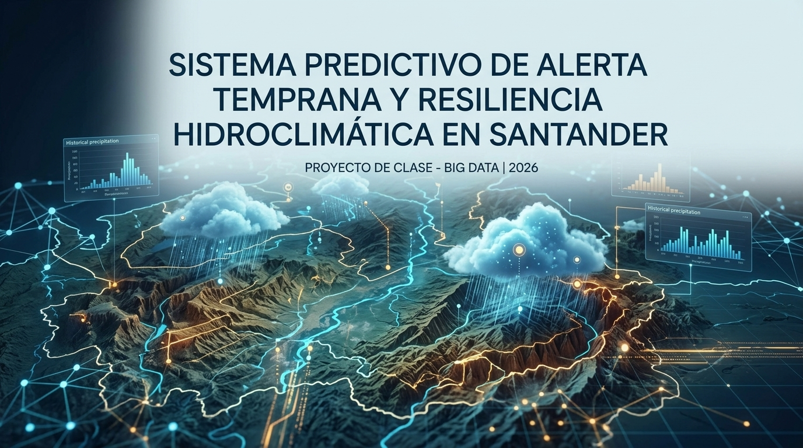

# Sistema Predictivo de Alerta Temprana y Resiliencia Hidroclimática en Santander

<p align="center">
  
</p>

Plataforma distribuida de Big Data (Arquitectura Híbrida Lambda + Medallón) para el modelado estadístico sobre 292 millones de registros históricos del IDEAM y la **predicción temprana de eventos extremos de precipitación (Horizonte T+3h)** en el departamento de Santander, Colombia.

- **Demo Operativo en Vivo (Centro de Mando Web):** https://big-data-uis-5vob.vercel.app/
- **Fuente Primaria (Histórico Pluviométrico):** Datos Abiertos Colombia - Precipitación IDEAM (`s54a-sgyg`)
- **Fuente Geodésica Complementaria:** Catálogo Nacional de Estaciones del IDEAM (`hp9r-jxuu`)
- **Fuente Meteorológica Predictiva en Tiempo Real:** Open-Meteo Forecast API (coordenadas exactas `latitud` / `longitud`)

---

## Autores — Universidad Industrial de Santander (UIS)
- **Anthoni Lexandre Hernández Díaz** — `2191198`
- **Andrés Santiago Marín Forero** - `2243556`
- **Angie Nicole Boada Mogollón** - `2243672`
- **Laura Valentina Ortiz Villamizar** - `2243553`

---

## ¿Por qué una Arquitectura Big Data y NO solo una Base de Datos con una Página Web?

Conectar directamente una página web a una base de datos relacional tradicional (como PostgreSQL/Supabase) **fracasa** ante este problema por tres razones técnicas fundamentales:

1. **Colapso por Volumen y Escaneo Completo (292 Millones de Filas):** Cargar y consultar 292 millones de registros crudos en CSV dentro de una base de datos transaccional (OLTP) agota la memoria RAM e impide calcular percentiles exactos ($P_{90}$ y $P_{99}$) sin bloquear las lecturas del dashboard web.
2. **Enfoque Predictivo vs. Reactivo:** Un sensor que solo reporta "está lloviendo ahora" no previene desastres. Para predecir una inundación con **3 horas de anticipación ($T+3\text{ h}$)**, el sistema necesita cruzar en milisegundos el pronóstico satelital entrante (Open-Meteo en la latitud y longitud exacta de la estación) más la saturación antecedente del suelo contra la distribución probabilística histórica de los últimos 26 años calculada en paralelo.
3. **Desacoplamiento entre Procesamiento Pesado y Consumo en Tiempo Real:** Si el motor analítico y el dashboard compartieran un único servidor relacional, cada re-entrenamiento histórico tumbaría la aplicación web de la Unidad de Gestión del Riesgo.

### Rol Técnico de Cada Componente en Nuestro Ecosistema

| Tecnología | Rol en la Arquitectura | ¿Por qué es indispensable y cómo se consulta en tiempo real? |
| :--- | :--- | :--- |
| **Docker & Docker Compose** | Orquestación y Aislamiento de Clúster | Garantiza reproducibilidad absoluta sin instalar Java 17, Hadoop ni brokers manualmente en el sistema operativo anfitrión. Aísla la red interna (`kafka:29092`, `minio:9000`) mediante contenedores ligeros. |
| **MinIO (Almacenamiento de Objetos S3)** | Data Lake Distribuido (Capas Bronce, Plata y Oro) | Reemplaza el almacenamiento local rígido por almacenamiento de objetos compatible con Amazon S3 (`s3://bronce`, `s3://plata`, `s3://oro`). Permite escalar horizontalmente (*Scale-Out*) terabytes de datos inmutables y consultarlos vía API S3 (`http://localhost:9000`) o consola web (`http://localhost:9001`). |
| **Apache Parquet + Particionamiento Lógico** | Formato Columnar Comprimido | En lugar de leer gigabytes de texto plano CSV fila por fila, Parquet almacena los datos por columnas con compresión Snappy y estadísticas de bloque (*min/max*). El **particionamiento lógico por `departamento` y `anio`** permite aplicar *Partition Pruning* (saltar carpetas enteras en disco) y evita el *Small Files Problem*. |
| **Apache Spark (PySpark)** | Motor de Procesamiento Distribuido en Lotes (Batch) | Ejecuta en memoria distribuida la limpieza y cruce geodésico con el Catálogo Nacional (`hp9r-jxuu`) en la Capa Plata, y entrena en la Capa Oro el modelo hidrológico predictivo por estación: acumulados móviles de 3 horas (`umbral_3h_p90`, `umbral_3h_p99`), Índice de Precipitación Antecedente (`api_critico_24h_mm`), coeficiente de escorrentía (`coef_escorrentia`), probabilidad condicional de transición de Markov $\mathbb{P}(\text{Exceso}_{t+3\text{h}} \mid \text{Saturación}_t)$ y ventana de evacuación preventiva (`ventana_evacuacion_min`). |
| **Apache Kafka (Modo KRaft)** | Broker Distribuido de Eventos en Streaming | Ingiere con latencia de milisegundos las ráfagas de vectores predictivos (lluvia actual + pronóstico a $T+3\text{ h}$ y $T+6\text{ h}$ + probabilidad de desbordamiento + saturación del suelo) particionados por `codigoestacion`. Desacopla los sensores/APIs meteorológicas del motor de inferencia mediante *offsets* persistentes. |
| **Supabase Realtime + React (Vite)** | Capa de Servicio (*Serving Layer*) y UI Geoespacial | Implementa la jerarquía **Predicción Primero (Nivel 1: Tarjetas de Impacto Anticipado $T+3\text{h}/T+6\text{h}$)** e **Información Después (Nivel 2: Respaldo Histórico Spark 2000–2026)**, difundiendo alertas por WebSockets a todos los navegadores conectados sin recargar la página. |

---

## Estructura del Repositorio

```text
BIG_DATA-UIS/
├── compose.yaml                                  # Orquestación principal (MinIO, Kafka KRaft, Spark Processor, Web)
├── vercel.json                                   # Configuración de despliegue continuo en Vercel
├── SECURITY.md                                   # Política de seguridad (Credenciales, RLS Supabase y PowerShell)
├── docker/
│   ├── Dockerfile                                # Imagen con Python 3.11 + OpenJDK 17 + PySpark
│   └── docker-compose.yml                        # Manifiesto de contenedores sincronizado
├── docs/
│   ├── INFORME_TECNICO_FINAL.md                  # Informe técnico detallado del sistema predictivo
│   ├── GUION_DEMOSTRACION_3_MINUTOS.md           # Guion minuto a minuto para la sustentación (180 s)
│   └── evidencias/                               # Capturas de ejecución de MinIO, Spark, Kafka y Supabase
├── data/
│   ├── raw_sample/
│   │   ├── ideam_precipitacion_raw_sample.csv    # Muestra verificable Capa Bronce: Precipitaciones (s54a-sgyg)
│   │   └── ideam_catalogo_estaciones_sample.csv  # Muestra verificable Capa Bronce: Catálogo Estaciones (hp9r-jxuu)
│   └── processed_sample/
│       ├── ideam_plata_sample.parquet            # Muestra verificable Capa Plata (Parquet y CSV limpio + altitud)
│       ├── ideam_oro_sample.parquet              # Muestra verificable Capa Oro (Umbrales 3h, API 24h, Markov, Evac)
│       └── ideam_streaming_alerts_sample.json    # Muestra verificable de predicciones T+3h/T+6h en Kafka
├── src/
│   ├── ingestion/
│   │   └── ingest_ideam.py                       # Extracción IDEAM (s54a-sgyg + catálogo hp9r-jxuu) hacia s3://bronce
│   ├── batch/
│   │   ├── bronze_to_silver.py                   # Limpieza, cruce geodésico con hp9r-jxuu y Parquet en s3://plata
│   │   ├── silver_to_gold.py                     # Entrenamiento hidrológico Spark (Ventanas 3h/24h + Markov) en s3://oro
│   │   └── supabase_schema.sql                   # Esquema PostgreSQL, publicación Realtime y políticas RLS
│   └── streaming/
│       ├── kafka_producer.py                     # Emisor determinista (Open-Meteo + Spark; soporta --stress-test)
│       └── kafka_consumer.py                     # Inferencia continua en tiempo real hacia Supabase Realtime
└── web-dashboard/                                # Centro de Mando en React + Vite + Tailwind CSS
    ├── Dockerfile                                # Contenedor del frontend
    └── src/
        ├── components/                           # Navbar, AlertsSidebar, GeospatialMap, GoldLayerTable, ProtocolModal
        └── lib/                                  # Cliente Supabase, reglas hidrológicas y pruebas unitarias
```

---

## Guía de Instalación y Ejecución Desde Cero (Paso a Paso para Windows)

Sigue esta guía si acabas de formatear el computador o vas a reproducir el proyecto desde cero en Windows 10/11.

### Paso 0: Instalación de Prerrequisitos en Windows
1. **Git:** Descárgalo e instálalo desde https://git-scm.com/download/win
2. **Docker Desktop:** Descárgalo desde https://www.docker.com/products/docker-desktop/
   - Durante la instalación, deja marcada la opción **"Use WSL 2 instead of Hyper-V"**.
   - Abre Docker Desktop y espera a que el indicador inferior izquierdo diga **"Engine running"** (color verde).
3. **Python (Versión recomendada 3.11 o 3.12):** Descárgalo desde https://www.python.org/downloads/
   - **IMPORTANTE:** En la primera ventana del instalador de Python, marca obligatoriamente la casilla **"Add python.exe to PATH"**.
4. **Node.js (Versión LTS 20 o superior):** Descárgalo desde https://nodejs.org/ para ejecutar el dashboard en React.

Verifica en una terminal PowerShell que las cuatro herramientas respondan correctamente:

```powershell
git --version
docker --version
python --version
node --version
```

### Paso 1: Clonar el Repositorio y Habilitar Permisos en PowerShell (Security Policy)
Por defecto, la directiva de seguridad de Windows bloquea la ejecución de scripts y entornos virtuales en PowerShell (`PSSecurityException`). Abre PowerShell y ejecuta:

```powershell
# 1. Habilitar la ejecución de scripts locales firmados en tu usuario de Windows
Set-ExecutionPolicy -ExecutionPolicy RemoteSigned -Scope CurrentUser -Force

# 2. Clonar el repositorio y entrar a la carpeta
git clone https://github.com/Nightshadow7/BIG_DATA-UIS.git
cd BIG_DATA-UIS
```

### Paso 2: Crear y Activar el Entorno Virtual de Python (`venv`)
Nunca instales las librerías en el Python global de Windows. Crea y activa el entorno virtual aislado con estos comandos:

```powershell
# 1. Crear el entorno virtual en la carpeta 'venv'
python -m venv venv

# 2. Activar el entorno virtual en PowerShell (verás '(venv)' al inicio de la línea)
.\venv\Scripts\Activate.ps1

# 3. Actualizar pip, setuptools y wheel (evita errores de compilación en Windows)
python -m pip install --upgrade pip setuptools wheel

# 4. Instalar las dependencias del proyecto
pip install -r requirements.txt
```

### Paso 3: Configurar las Variables de Entorno (`.env`)
Crea tu archivo `.env` local a partir de la plantilla:

```powershell
Copy-Item .env.example .env
```

Abre el archivo `.env` en VS Code o Bloc de Notas y verifica que contenga:
- `SUPABASE_URL`: La URL raíz de tu proyecto en Supabase (ej. `https://kofaoizeukbugvseckbq.supabase.co` **sin** `/rest/v1/` al final).
- `SUPABASE_KEY`: Tu llave `Secret key` (`sb_secret_...` o `service_role`) para el backend.
- `VITE_SUPABASE_URL` y `VITE_SUPABASE_ANON_KEY`: La URL y llave pública (`sb_publishable_...` o `anon`) para compilar el frontend en `web-dashboard`.

### Paso 4: Levantar el Data Lake (MinIO) y el Broker de Streaming (Kafka) en Docker
Asegúrate de tener Docker Desktop abierto y ejecuta:

```powershell
docker compose up -d
```

Verifica que los contenedores estén activos:

```powershell
docker compose ps
```

- **Consola Web del Data Lake (MinIO):** Abre http://localhost:9001 en tu navegador e inicia sesión con Usuario `admin` y Contraseña `minioadmin123`. Allí podrás inspeccionar en vivo los buckets `bronce`, `plata` y `oro`.
- **API S3 de MinIO:** `http://localhost:9000`
- **Broker Apache Kafka:** `localhost:9092` (para tus scripts en Windows) y `kafka:29092` (para contenedores internos de Docker).

### Paso 5: Ejecutar el Pipeline Batch en Apache Spark (Bronce -> Plata -> Oro)
Dado que Apache Spark requiere Java 17 y binarios de Hadoop que suelen fallar en Windows nativo, el proyecto ejecuta PySpark dentro del contenedor `spark-processor` con un solo comando:

```powershell
# 1. Descargar precipitaciones (s54a-sgyg) y Catálogo Nacional de Estaciones (hp9r-jxuu) hacia s3://bronce
docker compose run --rm spark-processor python src/ingestion/ingest_ideam.py

# 2. Limpiar en PySpark, cruzar altitud y coordenadas oficiales (hp9r-jxuu) y escribir Parquet particionado en s3://plata
docker compose run --rm spark-processor python src/batch/bronze_to_silver.py

# 3. Entrenar modelo hidrológico en s3://oro (Ventanas móviles 3h, API 24h/72h, Transición de Markov) y sincronizar con Supabase
docker compose run --rm spark-processor python src/batch/silver_to_gold.py
```

### Paso 6: Ejecutar la Predicción en Tiempo Real con Apache Kafka (Streaming T+3h / T+6h)
El productor consulta por defecto **100% los datos reales de la API satelital Open-Meteo** combinados con los coeficientes hidrológicos de Apache Spark. Si durante la sustentación en clase el día está soleado en Santander y necesitas demostrar la activación de alertas críticas y protocolos de evacuación, utiliza la bandera explícita `--stress-test`:

```powershell
# Modo 1 (Por defecto — 100% Datos Reales Open-Meteo + Modelo Hidrológico Spark):
python src/streaming/kafka_producer.py

# Modo 2 (Simulación de Tormenta Extrema para Demostración en Clase):
python src/streaming/kafka_producer.py --stress-test

# Consumidor en flujo continuo en tiempo real (Ctrl+C para detener, o --max-messages 26 para lote):
python src/streaming/kafka_consumer.py
```

También puedes ejecutarlos directamente dentro del contenedor Docker (sin depender del Python local de Windows):

```powershell
docker compose run --rm spark-processor python src/streaming/kafka_producer.py
docker compose run --rm spark-processor python src/streaming/kafka_producer.py --stress-test
docker compose run --rm spark-processor python src/streaming/kafka_consumer.py
```

### Paso 7: Ejecutar el Centro de Mando Web (React + Vite) en Local
Si deseas correr la aplicación web localmente en lugar de usar el enlace de Vercel:

```powershell
cd web-dashboard
npm install
npm run dev
```

Abre http://localhost:5173 en tu navegador. Para ejecutar las pruebas unitarias de las reglas hidrológicas:

```powershell
npm test
```

---

## Política de Seguridad (Security Policy: PowerShell, Credenciales y RLS en Supabase)

El proyecto implementa tres capas de seguridad documentadas en `SECURITY.md` y en `src/batch/supabase_schema.sql`:

1. **Directiva de Ejecución en Windows PowerShell (`ExecutionPolicy`):**
   - En lugar de deshabilitar globalmente la seguridad de Windows con `Unrestricted`, se aplica `Set-ExecutionPolicy -ExecutionPolicy RemoteSigned -Scope CurrentUser -Force`. Esto permite ejecutar scripts locales del entorno virtual (`.\venv\Scripts\Activate.ps1`) sin requerir permisos de Administrador y manteniendo el bloqueo sobre scripts externos no firmados.
2. **Aislamiento de Secretos entre Backend y Frontend:**
   - El archivo `.env` está excluido en `.gitignore`. El backend de PySpark y Kafka utiliza `SUPABASE_KEY` (`service_role` / `sb_secret_...`) para escribir en la Capa Oro, mientras que el navegador utiliza únicamente `VITE_SUPABASE_ANON_KEY` (`anon` / `sb_publishable_...`).
3. **Row Level Security (RLS) en PostgreSQL / Supabase (`src/batch/supabase_schema.sql`):**
   - Ambas tablas (`public.umbrales_estaciones` y `public.alertas_activas`) tienen activado `ENABLE ROW LEVEL SECURITY`.
   - La tabla `umbrales_estaciones` permite `SELECT` público para visualización en el mapa, pero restringe la escritura exclusivamente al rol `service_role` del pipeline de Apache Spark.
   - La tabla `alertas_activas` permite `SELECT` en tiempo real vía WebSockets (`supabase_realtime`) y autoriza `INSERT` / `UPDATE` para el motor de inferencia de Kafka y el cierre de protocolos preventivos de la UNGRD.

---

## Solución de Problemas Frecuentes en Windows (Troubleshooting)

1. **Error `Activate.ps1 cannot be loaded because running scripts is disabled on this system` (`PSSecurityException`):**
   - **Causa:** Restricción por defecto de la política de seguridad (`ExecutionPolicy: Restricted`) de PowerShell en Windows.
   - **Solución:** Ejecuta `Set-ExecutionPolicy -ExecutionPolicy RemoteSigned -Scope CurrentUser -Force` y vuelve a correr `.\venv\Scripts\Activate.ps1`.
2. **Error `open //./pipe/dockerDesktopLinuxEngine: The system cannot find the file specified`:**
   - **Causa:** El motor de Docker Desktop está apagado o WSL 2 no ha terminado de iniciar.
   - **Solución:** Abre la aplicación Docker Desktop en Windows y espera a que el indicador inferior izquierdo pase a verde (`Engine running`).
3. **Error `Failed to build 'pyarrow' when getting requirements to build wheel` o `ModuleNotFoundError: No module named 'pkg_resources'`:**
   - **Causa:** Versión desactualizada de `pip`/`setuptools` o intento de compilar `pyarrow` desde código fuente en Python 3.13/3.14 sobre Windows.
   - **Solución:** Ejecuta `python -m pip install --upgrade pip setuptools wheel` antes de correr `pip install -r requirements.txt` (el cual ya fija `pyarrow>=18.0.0` con binarios precompilados para Windows).
4. **Error `postgrest.exceptions.APIError: {'message': 'Invalid path specified in request URL', 'code': 'PGRST125'}`:**
   - **Causa:** Se copió la URL de Supabase incluyendo `/rest/v1/` al final.
   - **Solución:** En el archivo `.env`, deja únicamente la URL base (`https://kofaoizeukbugvseckbq.supabase.co`).
5. **Error `Java gateway process exited before sending its port number` al correr PySpark fuera de Docker:**
   - **Causa:** Windows no tiene instalado Java 17 ni `winutils.exe` configurado en `HADOOP_HOME`.
   - **Solución:** Ejecuta siempre los trabajos de Spark mediante el contenedor preparado: `docker compose run --rm spark-processor python src/batch/bronze_to_silver.py`.
6. **Error `ValueError: Invalid file descriptor: -1` al conectar a Kafka desde Windows con Python 3.13 o 3.14:**
   - **Causa:** En Windows, el selector de sockets de Python falla durante el sondeo automático de versión (`check_version`) de `kafka-python` cuando no se especifica la versión del broker.
   - **Solución:** Ya está corregido en `src/streaming/kafka_producer.py` y `src/streaming/kafka_consumer.py` fijando explícitamente `api_version=(3, 7, 0)`. Si el puerto `9092` aún no responde, verifica que el contenedor `streaming-kafka` esté arriba con `docker compose ps`.
