# Informe Tecnico: Sistema Predictivo de Alerta Temprana y Resiliencia Hidroclimatica en Santander

**Universidad Industrial de Santander (UIS)**
**Facultad de Ingenierias Fisicomecanicas — Escuela de Ingenieria de Sistemas e Informatica**
**Asignatura:** Procesamiento Distribuido y Grandes Volumenes de Datos (Big Data)

**Autores:**
* Anthoni Lexandre Hernandez — Codigo `2191198`
* Andres Santiago Marin
* Angie Nicol Boada
* Laura Valentina Ortiz

**Despliegue en Produccion (Centro de Mando Predictivo):** [https://big-data-uis-5vob.vercel.app/](https://big-data-uis-5vob.vercel.app/)

---

## 1. Planteamiento del Problema y Cambio de Paradigma: De Informacion Reactiva a Prediccion Anticipada ($T+3\text{ h}$)

El departamento de Santander presenta una configuracion topografica e hidrografica de alta vulnerabilidad frente a eventos hidrometeorologicos extremos. La interaccion entre los valles calidos y humedos del Magdalena Medio (Puerto Wilches, Barrancabermeja, Cimitarra, Puerto Parra) y las vertientes abruptas de la Cordillera Oriental (cuencas de los rios Lebrija, Suratá, Rio de Oro, Fonce y Suarez) produce regimenes de precipitacion altamente asimetricos. En municipios de ladera como Tona, Suratá, El Playon, Lebrija, Piedecuesta o Socorro, los tiempos de concentracion hidraulica son cortos: una tormenta intensa en la parte alta de la microcuenca se transforma en una creciente subita o avenida torrencial en cuestion de una a tres horas.

Un sistema tradicional meramente informativo o reactivo —que se limita a reportar que esta lloviendo cuando el pluviometro ya registro el aguacero— carece de utilidad operativa para la gestion del riesgo de desastres, porque cuando el sensor marca un acumulado critico el desbordamiento ya esta en curso. Para que un Sistema de Alerta Temprana (SAT) salve vidas y permita activar los protocolos de la Unidad Nacional para la Gestion del Riesgo de Desastres (UNGRD), debe responder con anticipacion tres preguntas fundamentales:

1. **Donde va a llover:** Localizacion geodesica exacta (latitud y longitud oficial de cada estacion y su cuenca tributaria).
2. **Cuanta agua se proyecta acumular en las proximas horas ($T+3\text{ h}$ y $T+6\text{ h}$):** Combinando la humedad antecedente del suelo con el pronostico satelital entrante.
3. **Si ese volumen futuro superara la capacidad historica de la microcuenca:** Contrastando la proyeccion contra los percentiles $P_{90}$ y $P_{99}$ especificos de esa estacion calculados sobre decadas de datos historicos.

Para resolver este desafio, diseno e implemento una **Arquitectura Hibrida Predictiva (Medallon + Streaming de Inferencia Anticipada)** que une el procesamiento masivo en lote con **Apache Spark (PySpark)** sobre el historico del IDEAM con vectores de pronostico satelital en tiempo real consultados por coordenadas exactas en **Open-Meteo API** y transmitidos mediante **Apache Kafka**.

---

## 2. Fuentes de Datos Abiertos, Coordenadas Geodesicas y API Meteorologica

El pipeline integra tres fuentes abiertas y verificables que garantizan trazabilidad desde el dato oficial hasta la verificacion satelital en vivo:

1. **Registros Historicos de Precipitacion del IDEAM (`s54a-sgyg` — Datos Abiertos Colombia):**
   * **URL:** [https://www.datos.gov.co/Ambiente-y-Desarrollo-Sostenible/Precipitaci-n/s54a-sgyg](https://www.datos.gov.co/Ambiente-y-Desarrollo-Sostenible/Precipitaci-n/s54a-sgyg)
   * **Alcance:** Serie historica filtrada desde el ano 2000 (`fechaobservacion >= '2000-01-01T00:00:00.000'`) con lecturas pluviometricas horarias y diarias (`valorobservado` en mm), codigo de estacion, municipio, departamento y zona hidrografica.
2. **Catalogo Nacional de Estaciones del IDEAM (`hp9r-jxuu` — Datos Abiertos Colombia):**
   * **URL:** [https://www.datos.gov.co/Ambiente-y-Desarrollo-Sostenible/Catalogo-Nacional-de-Estaciones-del-IDEAM/hp9r-jxuu/about_data](https://www.datos.gov.co/Ambiente-y-Desarrollo-Sostenible/Catalogo-Nacional-de-Estaciones-del-IDEAM/hp9r-jxuu/about_data)
   * **Alcance:** Ficha tecnica oficial de cada estacion hidrometeorologica (`codigoestacion`, categoria, tecnologia automatica o convencional, estado operativo, altitud sobre el nivel del mar, subzona hidrografica y coordenadas geodesicas exactas `latitud` y `longitud` en el sistema WGS84).
3. **API Predictiva por Latitud y Longitud Exacta — Open-Meteo (`api.open-meteo.com`):**
   * **Endpoint:** `https://api.open-meteo.com/v1/forecast`
   * **Variables consultadas por coordenada:** `precipitation` (lluvia horaria proyectada para las proximas 3 a 24 horas en mm), `precipitation_probability` (probabilidad porcentual de ocurrencia) y `soil_moisture_0_to_7cm` (fraccion volumetrica de humedad superficial del suelo).
4. **Verificadores Visuales de Coordenadas y Radar Satelital (`windy.com` y `geojson.io`):**
   * El Centro de Mando web enlaza directamente las coordenadas (`latitud`, `longitud`) de cada una de las 26 estaciones hacia el radar meteorologico interactivo de [https://www.windy.com](https://www.windy.com) y permite validar la malla espacial sobre [https://geojson.io](https://geojson.io).

### Caracterizacion de las 5 V del Big Data en el Sistema Predictivo

| Dimension | Comportamiento en el Pipeline Hidroclimatico Predictivo |
| :--- | :--- |
| **Volumen** | La serie nacional del IDEAM supera los 290 millones de registros historicos. Su almacenamiento y escaneo eficiente exige compresion columnar en Apache Parquet (`snappy`) y particionamiento jerarquico en MinIO S3. |
| **Velocidad** | El productor de Kafka consulta pronosticos satelitales horarios para las coordenadas de cada estacion y emite vectores predictivos que el consumidor evalua en menos de 20 milisegundos, publicando alertas anticipadas ($T+3\text{ h}$) via WebSockets. |
| **Variedad** | Fusiona tres naturalezas de datos: series historicas tabulares (CSV/Parquet en S3), metadatos geodesicos de estaciones (`hp9r-jxuu`) y payloads JSON de modelos numericos de prediccion meteorologica (Open-Meteo API en Kafka). |
| **Veracidad** | Los sensores en campo presentan ruido instrumental, valores negativos, picos espurios ($>500\text{ mm}$) y coordenadas truncadas. El job `bronze_to_silver.py` aplica filtros de integridad fisica y geografica antes de construir la linea base. |
| **Valor** | Convierte datos crudos en **tiempo de anticipacion operativa**: permite evacuar riberas y activar Consejos Municipales de Gestion del Riesgo hasta 3 horas antes de que se presente el pico de escorrentia, aun cuando la lluvia actual sea menor a $2\text{ mm}$. |

---

## 3. Arquitectura Hibrida de la Solucion (Medallon + Streaming Predictivo)

```mermaid
flowchart LR
    subgraph Fuentes["Fuentes Oficiales y Satelitales"]
        API_IDEAM["API Socrata IDEAM (s54a-sgyg / hp9r-jxuu)"]
        OPEN_METEO["Open-Meteo Forecast API (Lat/Lon Exacta)"]
    end

    subgraph DataLake["Data Lake MinIO S3 (Arquitectura Medallon)"]
        B[("s3://bronce (CSV Crudo)")]
        S[("s3://plata (Parquet Particionado)")]
        G[("s3://oro (Umbrales P90/P99)")]
    end

    subgraph Batch["Motor Batch: Apache Spark (PySpark)"]
        J1["bronze_to_silver.py (Limpieza y Calidad)"]
        J2["silver_to_gold.py (Calculo P90 y P99)"]
    end

    subgraph Streaming["Motor Predictivo T+3h: Apache Kafka KRaft"]
        KP["kafka_producer.py (Saturacion + Pronostico 3h)"]
        TOPIC[["Topic: telemetria-precipitacion"]]
        KC["kafka_consumer.py (Inferencia Anticipada)"]
    end

    subgraph Serving["Persistencia y Centro de Mando"]
        SB[("Supabase PostgreSQL + Realtime")]
        UI["React + Vite Dashboard (Vercel + Windy Radar)"]
    end

    API_IDEAM -->|ingest_ideam.py| B
    B --> J1 --> S
    S --> J2 --> G
    J2 -->|Upsert 26 estaciones| SB
    G -->|Coordenadas + P90/P99| KP
    OPEN_METEO -->|Pronostico 3h + Humedad Suelo| KP
    KP -->|Key: codigoestacion| TOPIC
    TOPIC --> KC
    G -->|Umbrales de referencia| KC
    KC -->|Alerta Temprana T+3h| SB
    SB <-->|WebSockets + REST| UI
```

---

## 4. Procesamiento Batch en Apache Spark: Linea Base Historica ($P_{90}$ y $P_{99}$)

### 4.1. Limpieza y Particionamiento (`src/batch/bronze_to_silver.py`)
El job de PySpark lee el archivo crudo desde `s3a://bronce/ideam_precipitacion_raw.csv` y ejecuta cuatro etapas de depuracion distribuida:
1. **Tipado explicito:** Conversion de `valorobservado`, `latitud` y `longitud` a `DoubleType`, y parseo de `fechaobservacion` a `TimestampType` derivando las columnas `anio` y `mes`.
2. **Filtro de veracidad fisica y geografica:** Retencion exclusiva de lecturas con $0 \le \text{valorobservado} \le 500\text{ mm}$ y coordenadas dentro del territorio continental colombiano ($-4.5^\circ \le \text{latitud} \le 13.5^\circ$ y $-82.0^\circ \le \text{longitud} \le -66.0^\circ$).
3. **Deduplicacion:** Eliminacion de eventos repetidos sobre la llave compuesta `(codigoestacion, fechaobservacion)`.
4. **Escritura particionada:** Almacenamiento en `s3a://plata/precipitaciones_limpias.parquet` particionado por `departamento` y `anio`, habilitando *partition pruning* para que el calculo sobre Santander lea unicamente los bloques fisicos del departamento.

### 4.2. Modelado de Percentiles en la Capa Oro (`src/batch/silver_to_gold.py`)
Sobre los registros depurados de Santander con lluvia efectiva ($\text{valorobservado} > 0$), Spark SQL calcula para cada estacion el percentil 90 y el percentil 99 mediante `percentile_approx`:

$$\text{Umbral Vigilancia Predictiva } (P_{90}) = \text{percentile\_approx}(\text{valorobservado}, 0.90)$$

$$\text{Umbral Desbordamiento Critico } (P_{99}) = \text{percentile\_approx}(\text{valorobservado}, 0.99)$$

### 4.3. Resultados Reales de la Capa Oro (26 Estaciones Modeladas en Santander)

La siguiente tabla presenta el catalogo completo generado por PySpark en `s3a://oro/umbrales_estaciones_oro.parquet` y verificado en `data/processed_sample/ideam_oro_sample.csv`, ordenado de mayor a menor umbral critico $P_{99}$:

| Codigo IDEAM | Nombre de la Estacion | Municipio | Zona Hidrografica | Latitud | Longitud | Media (mm) | Max (mm) | P90 Naranja (mm) | P99 Roja (mm) |
| :--- | :--- | :--- | :--- | :---: | :---: | :---: | :---: | :---: | :---: |
| `23187010` | PUERTO WILCHES [23187010] | PUERTO WILCHES | MEDIO MAGDALENA | 7.3483 | -73.9056 | 2.66 | 30.2 | **3.6** | **26.8** |
| `23127060` | SANTA ROSA - AUT [23127060] | CIMITARRA | MEDIO MAGDALENA | 6.2919 | -74.0983 | 1.98 | 21.6 | **2.6** | **19.8** |
| `24017640` | LA CEIBA - AUT [24017640] | SOCORRO | SOGAMOSO | 6.4489 | -73.3069 | 1.71 | 30.8 | **3.4** | **18.8** |
| `23127050` | PUERTO PARRA - AUT [23127050] | PUERTO PARRA | MEDIO MAGDALENA | 6.6514 | -74.0609 | 2.13 | 16.4 | **4.0** | **16.4** |
| `23180070` | SABANA DE TORRES [23180070] | SABANA DE TORRES | MEDIO MAGDALENA | 7.3924 | -73.5015 | 1.38 | 19.6 | **1.8** | **14.6** |
| `23155030` | AEROPUERTO YARIGUIES [23155030] | BARRANCABERMEJA | MEDIO MAGDALENA | 7.0186 | -73.8063 | 1.24 | 13.3 | **1.4** | **13.3** |
| `2319500043` | FLORIDABLANCA - AUT [2319500043] | FLORIDABLANCA | MEDIO MAGDALENA | 7.0568 | -73.0906 | 1.13 | 16.5 | **1.6** | **12.6** |
| `23195040` | UNIVERSIDAD INDUSTRIAL SANTANDER [23195040] | BUCARAMANGA | MEDIO MAGDALENA | 7.1419 | -73.1225 | 1.21 | 11.0 | **2.6** | **11.0** |
| `23190440` | NARANJO EL [23190440] | LEBRIJA | MEDIO MAGDALENA | 7.2050 | -73.2997 | 1.15 | 10.1 | **1.6** | **10.1** |
| `24027070` | MERIDA - AUT [24027070] | PARAMO | SOGAMOSO | 6.4447 | -73.1583 | 0.90 | 9.8 | **1.2** | **9.8** |
| `2401500052` | PUENTE GUILLERMO - AUT [2401500052] | PUENTE NACIONAL | SOGAMOSO | 5.7964 | -73.7267 | 0.78 | 6.4 | **1.2** | **6.4** |
| `2319500065` | GRANJA PIEDECUESTA - AUT [2319500065] | PIEDECUESTA | MEDIO MAGDALENA | 6.9933 | -73.0678 | 0.65 | 10.7 | **1.0** | **5.0** |
| `23195110` | LLANO GRANDE - AUT [23195110] | GIRON | MEDIO MAGDALENA | 7.0256 | -73.1672 | 0.54 | 8.2 | **1.0** | **4.9** |
| `23190130` | TONA - AUT [23190130] | TONA | MEDIO MAGDALENA | 7.1997 | -72.9692 | 0.64 | 5.0 | **1.4** | **4.2** |
| `2401500051` | SUAITA - AUT [2401500051] | SUAITA | SOGAMOSO | 6.1037 | -73.4401 | 0.62 | 4.8 | **1.3** | **3.9** |
| `23195200` | CACHIRI - AUT [23195200] | SURATA | MEDIO MAGDALENA | 7.4739 | -72.9911 | 0.56 | 8.4 | **1.1** | **3.8** |
| `24015110` |SAN BENITO - AUT [24015110] | SAN BENITO | SOGAMOSO | 6.1277 | -73.5094 | 0.51 | 3.7 | **1.1** | **3.7** |
| `24035340` | CAPITANEJO - AUT [24035340] | CAPITANEJO | SOGAMOSO | 6.5307 | -72.6997 | 0.50 | 3.5 | **1.3** | **3.5** |
| `24025090` | CHARALA - AUT [24025090] | CHARALA | SOGAMOSO | 6.2923 | -73.1462 | 0.52 | 3.3 | **1.3** | **3.3** |
| `2319500083` | EL PLAYON - AUT [2319500083] | EL PLAYON | MEDIO MAGDALENA | 7.4682 | -73.2045 | 0.56 | 3.1 | **1.2** | **3.1** |
| `23195090` | VIVERO SURATA - AUT [23195090] | SURATA | MEDIO MAGDALENA | 7.3658 | -72.9875 | 0.37 | 2.7 | **0.6** | **2.7** |
| `37015030` | BERLIN - AUT [37015030] | TONA | ARAUCA | 7.1870 | -72.8685 | 0.38 | 2.8 | **0.7** | **2.3** |
| `24015300` | MOGOTES - AUT [24015300] | MOGOTES | SOGAMOSO | 6.4750 | -72.9714 | 0.25 | 2.2 | **0.5** | **2.2** |
| `24037370` | CARRIZAL - AUT [24037370] | CERRITO | SOGAMOSO | 6.8548 | -72.6908 | 0.27 | 1.9 | **0.6** | **1.9** |
| `24055070` |GUACA - AUT [24055070] | GUACA | SOGAMOSO | 6.8832 | -72.8588 | 0.23 | 1.6 | **0.4** | **1.6** |
| `24035410` | CONCEPCION - AUT [24035410] | CONCEPCION | SOGAMOSO | 6.7016 | -72.6968 | 0.14 | 0.2 | **0.2** | **0.2** |

---

## 5. Modelo Predictivo en Tiempo Real a Horizonte $T+3\text{ h}$ (Apache Kafka + Open-Meteo)

### 5.1. Formulacion Matematica del Indice Predictivo Acumulado
Para anticipar la emergencia antes de que ocurra el pico de lluvia en la estacion $i$, el productor (`src/streaming/kafka_producer.py`) consulta la API de Open-Meteo pasando las coordenadas exactas $(\text{lat}_i, \text{lon}_i)$ y construye el vector predictivo a un horizonte de 3 horas:

$$\hat{R}_{i, t+3\text{h}} = S_{i, t} + \sum_{k=1}^{3} \hat{P}_{i, t+k}$$

donde:
* $S_{i, t}$ (`saturacion_antecedente_mm`) representa la lamina de saturacion hidrica previa acumulada en la microcuenca, modulada por la humedad superficial del suelo (`soil_moisture_0_to_7cm`).
* $\sum_{k=1}^{3} \hat{P}_{i, t+k}$ (`pronostico_proximas_3h_mm`) es la precipitacion horaria proyectada por el modelo satelital en las proximas 3 horas sobre la coordenada exacta de la estacion.
* $\text{Prob}_{i, t+3\text{h}} = \max_{k \in \{1,2,3\}} (\text{precipitation\_probability}_{i, t+k})$ indica la probabilidad maxima de precipitacion en la ventana de prediccion.

### 5.2. Regla de Inferencia Anticipada en el Consumidor (`src/streaming/kafka_consumer.py`)
El consumidor del grupo `centro-mando-hidroclimatico` compara el indice predictivo $\hat{R}_{i, t+3\text{h}}$ (`valorobservado`) contra los umbrales historicos de la Capa Oro, independientemente de que la lluvia instantanea actual ($P_{i, t}$, `lluvia_actual_mm`) sea todavia baja:

* **$\hat{R}_{i, t+3\text{h}} \ge P_{99, i}$ $\rightarrow$ `ALERTA CRITICA` (Roja):** Se proyecta superacion del percentil 99 en las proximas 3 horas. Dispara alerta temprana en Supabase Realtime (`zona_id = 'north'`, `id = 1`) para alistamiento de evacuacion preventiva.
* **$P_{90, i} \le \hat{R}_{i, t+3\text{h}} < P_{99, i}$ $\rightarrow$ `VIGILANCIA` (Naranja):** Se proyecta lluvia severa entrante por encima del percentil 90. Dispara alerta preventiva (`zona_id = 'south'`, `id = 2`) para monitoreo de riberas y obras de drenaje.
* **$\hat{R}_{i, t+3\text{h}} < P_{90, i}$ $\rightarrow$ `NORMAL` (Verde):** El pronostico a 3 horas se mantiene dentro de la capacidad normal de absorcion de la cuenca.

### 5.3. Traza Verificable de Predicciones Procesadas en Apache Kafka

La siguiente tabla resume una muestra de los 25 vectores predictivos reales procesados por el cluster de Kafka y almacenados en `data/processed_sample/ideam_streaming_alerts_sample.csv` (particion `0`, offsets `44` a `68`), demostrando como el sistema detecta emergencias futuras incluso cuando la lluvia actual es menor a $2\text{ mm}$:

| Offset | Evento ID | Estacion (Municipio) | Coordenadas (Lat, Lon) | Lluvia Actual (mm) | Saturacion Ant. (mm) | Pronostico +3h (mm) | Proyeccion Total T+3h (mm) | Prob. (%) | Humedad Suelo (%) | P90 / P99 (mm) | Clasificacion Predictiva |
| :---: | :--- | :--- | :---: | :---: | :---: | :---: | :---: | :---: | :---: | :---: | :--- |
| `44` | `PRED-...-1` | Vivero Surata (Surata) | `7.3658, -72.9875` | 1.87 | 0.18 | 0.50 | **0.68** | 88% | 49.7% | 0.6 / 2.7 | **VIGILANCIA** |
| `45` | `PRED-...-2` | Tona - Aut (Tona) | `7.1997, -72.9692` | 0.28 | 1.32 | 4.72 | **6.04** | 87% | 49.4% | 1.4 / 4.2 | **ALERTA CRITICA** |
| `46` | `PRED-...-3` | Floridablanca - Aut | `7.0568, -73.0906` | 1.27 | 1.22 | 0.00 | **1.22** | 1% | 47.9% | 1.6 / 12.6 | **NORMAL** |
| `48` | `PRED-...-5` | Santa Rosa (Cimitarra) | `6.2919, -74.0983` | 1.77 | 1.24 | 0.00 | **1.24** | 0% | 48.4% | 2.6 / 19.8 | **NORMAL** |
| `51` | `PRED-...-8` | Granja Piedecuesta | `6.9933, -73.0678` | 1.95 | 1.32 | 4.93 | **6.25** | 93% | 46.9% | 1.0 / 5.0 | **ALERTA CRITICA** |
| `53` | `PRED-...-10` | Vivero Surata (Surata) | `7.3658, -72.9875` | 0.65 | 1.03 | 2.93 | **3.96** | 99% | 49.7% | 0.6 / 2.7 | **ALERTA CRITICA** |
| `55` | `PRED-...-12` | La Ceiba (Socorro) | `6.4489, -73.3069` | 1.65 | 6.11 | 19.26 | **25.37** | 95% | 48.9% | 3.4 / 18.8 | **ALERTA CRITICA** |
| `58` | `PRED-...-15` | La Ceiba (Socorro) | `6.4489, -73.3069` | 1.43 | 4.89 | 19.95 | **24.84** | 87% | 48.9% | 3.4 / 18.8 | **ALERTA CRITICA** |
| `60` | `PRED-...-17` | El Naranjo (Lebrija) | `7.2050, -73.2997` | 0.42 | 0.48 | 1.35 | **1.83** | 76% | 49.1% | 1.6 / 10.1 | **VIGILANCIA** |
| `66` | `PRED-...-23` | El Naranjo (Lebrija) | `7.2050, -73.2997` | 0.27 | 3.60 | 10.94 | **14.54** | 86% | 49.1% | 1.6 / 10.1 | **ALERTA CRITICA** |
| `67` | `PRED-...-24` | Tona - Aut (Tona) | `7.1997, -72.9692` | 1.86 | 1.66 | 3.71 | **5.37** | 94% | 49.4% | 1.4 / 4.2 | **ALERTA CRITICA** |

Como se observa en los offsets `45` (Tona), `55` (Socorro) y `66` (Lebrija), en el momento de la medicion la lluvia actual era minima (`0.28 mm`, `1.65 mm` y `0.27 mm`), por lo que un sistema tradicional habria reportado normalidad. Sin embargo, al integrar la saturacion antecedente con la celda de lluvia entrante a 3 horas (`4.72 mm`, `19.26 mm` y `10.94 mm`), el motor predictivo anticipa que se superara el umbral $P_{99}$ y emite la alerta temprana con tres horas de ventaja.

---

## 6. Centro de Mando Web, Verificacion en Windy.com y Protocolos Preventivos

El Centro de Mando desplegado en Vercel ([https://big-data-uis-5vob.vercel.app/](https://big-data-uis-5vob.vercel.app/)) consume en tiempo real las tablas `umbrales_estaciones` y `alertas_activas` de Supabase e integra cuatro capacidades operativas:

1. **Panel de Alertas Predictivas ($T+3\text{ h}$):** Muestra para cada sector la comparacion entre la lluvia actual, la proyeccion acumulada a 3 horas, la probabilidad porcentual de ocurrencia, la humedad del suelo y el porcentaje de carga frente al umbral $P_{99}$.
2. **Mapa Geoespacial de Santander con Verificacion en Windy.com:** Ubica las 26 estaciones del IDEAM sobre las cuencas del departamento e incluye en cada tarjeta un enlace directo con las coordenadas exactas (`latitud`, `longitud`) hacia el radar meteorologico en vivo de **Windy.com**, permitiendo al operador contrastar visualmente el desplazamiento de las nubes sobre la estacion.
3. **Proyeccion Interactiva desde el Navegador:** Al pulsar el boton **Proyectar T+3h** en cualquier estacion del mapa o de la tabla de la Capa Oro, la aplicacion consulta en vivo el endpoint `api.open-meteo.com/v1/forecast` para las coordenadas de esa estacion, calcula el vector predictivo y actualiza Supabase Realtime.
4. **Protocolo Preventivo UNGRD:** Permite gestionar la lista de chequeo preventiva (alistamiento de brigadas, verificacion de niveles aguas arriba y preaviso comunitario) y cerrar el ciclo de la alerta dejando trazabilidad en PostgreSQL.

---

## 7. Conclusiones

1. **Valor operativo de la prediccion frente a la reaccion:** La transicion de un esquema informativo a un modelo predictivo a horizonte $T+3\text{ h}$ resuelve la principal limitacion de los sistemas pluviometricos convencionales en cuencas de montana: otorga una ventana de accion de hasta 180 minutos antes de la avenida torrencial.
2. **Complementariedad entre Apache Spark y Open-Meteo:** Un pronostico meteorologico aislado de $15\text{ mm}$ en 3 horas no significa lo mismo en el valle medio del Magdalena que en el paramo de Berlin o Tona. Cruzar el pronostico satelital de Open-Meteo con los percentiles $P_{90}$ y $P_{99}$ calculados por Apache Spark sobre cada estacion particular permite emitir alertas calibradas a la realidad hidrologica de cada municipio.
3. **Reproducibilidad de extremo a extremo:** Toda la solucion se ejecuta de manera determinista mediante contenedores Docker (`compose.yaml`), cuenta con muestras verificables en formato CSV, Parquet y JSON dentro de `data/`, pruebas unitarias automatizadas en el frontend (`7/7` aprobadas) y despliegue continuo en produccion sobre Vercel.
