# Informe Tecnico: Sistema Predictivo de Alerta Temprana y Resiliencia Hidroclimatica en Santander

**Universidad Industrial de Santander (UIS)**
**Facultad de Ingenierias Fisicomecanicas — Escuela de Ingenieria de Sistemas e Informatica**
**Asignatura:** Procesamiento Distribuido y Grandes Volumenes de Datos (Big Data)

**Autores:**
* Anthoni Lexandre Hernandez — Codigo `2191198`
* Andres Santiago Marin
* Angie Nicol Boada
* Laura Valentina Ortiz

**Despliegue en Produccion (Centro de Mando Predictivo):** [https://big-data-uis-5vob.vercel.app/](https://big-data-uis-5vob.vercel.app/)

---

## 1. Planteamiento del Problema y Cambio de Paradigma: De Informacion Reactiva a Prediccion Anticipada ($T+3\text{ h}$)

El departamento de Santander presenta una configuracion topografica e hidrografica de alta vulnerabilidad frente a eventos hidrometeorologicos extremos. La interaccion entre los valles calidos y humedos del Magdalena Medio (Puerto Wilches, Barrancabermeja, Cimitarra, Puerto Parra) y las vertientes abruptas de la Cordillera Oriental (cuencas de los rios Lebrija, Suratá, Rio de Oro, Fonce y Suarez) produce regimenes de precipitacion altamente asimetricos. En municipios de ladera como Tona, Suratá, El Playon, Lebrija, Piedecuesta o Socorro, los tiempos de concentracion hidraulica son cortos: una tormenta intensa en la parte alta de la microcuenca se transforma en una creciente subita o avenida torrencial en cuestion de una a tres horas.

Un sistema tradicional meramente informativo o reactivo —que se limita a reportar que esta lloviendo cuando el pluviometro ya registro el aguacero— carece de utilidad operativa para la gestion del riesgo de desastres, porque cuando el sensor marca un acumulado critico el desbordamiento ya esta en curso. Para que un Sistema de Alerta Temprana (SAT) salve vidas y permita activar los protocolos de la Unidad Nacional para la Gestion del Riesgo de Desastres (UNGRD), debe responder con anticipacion tres preguntas fundamentales:

1. **Donde va a llover:** Localizacion geodesica exacta (latitud y longitud oficial de cada estacion y su cuenca tributaria).
2. **Cuanta agua se proyecta acumular en las proximas horas ($T+3\text{ h}$ y $T+6\text{ h}$):** Combinando la humedad antecedente del suelo con el pronostico satelital entrante.
3. **Si ese volumen futuro superara la capacidad historica de la microcuenca:** Contrastando la proyeccion contra los percentiles $P_{90}$ y $P_{99}$ especificos de esa estacion calculados sobre decadas de datos historicos.

Para resolver este desafio, diseno e implemento una **Arquitectura Hibrida Predictiva (Medallon + Streaming de Inferencia Anticipada)** que une el procesamiento masivo en lote con **Apache Spark (PySpark)** sobre el historico del IDEAM con vectores de pronostico satelital en tiempo real consultados por coordenadas exactas en **Open-Meteo API** y transmitidos mediante **Apache Kafka**.

---

## 2. Fuentes de Datos Abiertos, Coordenadas Geodesicas y API Meteorologica

El pipeline integra tres fuentes abiertas y verificables que garantizan trazabilidad desde el dato oficial hasta la verificacion satelital en vivo:

1. **Registros Historicos de Precipitacion del IDEAM (`s54a-sgyg` — Datos Abiertos Colombia):**
   * **URL:** [https://www.datos.gov.co/Ambiente-y-Desarrollo-Sostenible/Precipitaci-n/s54a-sgyg](https://www.datos.gov.co/Ambiente-y-Desarrollo-Sostenible/Precipitaci-n/s54a-sgyg)
   * **Alcance:** Serie historica filtrada desde el ano 2000 (`fechaobservacion >= '2000-01-01T00:00:00.000'`) con lecturas pluviometricas horarias y diarias (`valorobservado` en mm), codigo de estacion, municipio, departamento y zona hidrografica.
2. **Catalogo Nacional de Estaciones del IDEAM (`hp9r-jxuu` — Datos Abiertos Colombia):**
   * **URL:** [https://www.datos.gov.co/Ambiente-y-Desarrollo-Sostenible/Catalogo-Nacional-de-Estaciones-del-IDEAM/hp9r-jxuu/about_data](https://www.datos.gov.co/Ambiente-y-Desarrollo-Sostenible/Catalogo-Nacional-de-Estaciones-del-IDEAM/hp9r-jxuu/about_data)
   * **Alcance:** Ficha tecnica oficial de cada estacion hidrometeorologica (`codigoestacion`, categoria, tecnologia automatica o convencional, estado operativo, altitud sobre el nivel del mar, subzona hidrografica y coordenadas geodesicas exactas `latitud` y `longitud` en el sistema WGS84).
3. **API Predictiva por Latitud y Longitud Exacta — Open-Meteo (`api.open-meteo.com`):**
   * **Endpoint:** `https://api.open-meteo.com/v1/forecast`
   * **Variables consultadas por coordenada:** `precipitation` (lluvia horaria proyectada para las proximas 3 a 24 horas en mm), `precipitation_probability` (probabilidad porcentual de ocurrencia) y `soil_moisture_0_to_7cm` (fraccion volumetrica de humedad superficial del suelo).
4. **Verificadores Visuales de Coordenadas y Radar Satelital (`windy.com` y `geojson.io`):**
   * El Centro de Mando web enlaza directamente las coordenadas (`latitud`, `longitud`) de cada una de las 26 estaciones hacia el radar meteorologico interactivo de [https://www.windy.com](https://www.windy.com) y permite validar la malla espacial sobre [https://geojson.io](https://geojson.io).

### Caracterizacion de las 5 V del Big Data en el Sistema Predictivo

| Dimension | Comportamiento en el Pipeline Hidroclimatico Predictivo |
| :--- | :--- |
| **Volumen** | La serie nacional del IDEAM supera los 290 millones de registros historicos. Su almacenamiento y escaneo eficiente exige compresion columnar en Apache Parquet (`snappy`) y particionamiento jerarquico en MinIO S3. |
| **Velocidad** | El productor de Kafka consulta pronosticos satelitales horarios para las coordenadas de cada estacion y emite vectores predictivos que el consumidor evalua en menos de 20 milisegundos, publicando alertas anticipadas ($T+3\text{ h}$) via WebSockets. |
| **Variedad** | Fusiona tres naturalezas de datos: series historicas tabulares (CSV/Parquet en S3), metadatos geodesicos de estaciones (`hp9r-jxuu`) y payloads JSON de modelos numericos de prediccion meteorologica (Open-Meteo API en Kafka). |
| **Veracidad** | Los sensores en campo presentan ruido instrumental, valores negativos, picos espurios ($>500\text{ mm}$) y coordenadas truncadas. El job `bronze_to_silver.py` aplica filtros de integridad fisica y geografica antes de construir la linea base. |
| **Valor** | Convierte datos crudos en **tiempo de anticipacion operativa**: permite evacuar riberas y activar Consejos Municipales de Gestion del Riesgo hasta 3 horas antes de que se presente el pico de escorrentia, aun cuando la lluvia actual sea menor a $2\text{ mm}$. |

---

## 3. Arquitectura Hibrida de la Solucion (Medallon + Streaming Predictivo)

```mermaid
flowchart LR
    subgraph Fuentes["Fuentes Oficiales y Satelitales"]
        API_IDEAM["API Socrata IDEAM (s54a-sgyg / hp9r-jxuu)"]
        OPEN_METEO["Open-Meteo Forecast API (Lat/Lon Exacta)"]
    end

    subgraph DataLake["Data Lake MinIO S3 (Arquitectura Medallon)"]
        B[("s3://bronce (CSV Crudo)")]
        S[("s3://plata (Parquet Particionado)")]
        G[("s3://oro (Umbrales P90/P99)")]
    end

    subgraph Batch["Motor Batch: Apache Spark (PySpark)"]
        J1["bronze_to_silver.py (Limpieza y Calidad)"]
        J2["silver_to_gold.py (Calculo P90 y P99)"]
    end

    subgraph Streaming["Motor Predictivo T+3h: Apache Kafka KRaft"]
        KP["kafka_producer.py (Saturacion + Pronostico 3h)"]
        TOPIC[["Topic: telemetria-precipitacion"]]
        KC["kafka_consumer.py (Inferencia Anticipada)"]
    end

    subgraph Serving["Persistencia y Centro de Mando"]
        SB[("Supabase PostgreSQL + Realtime")]
        UI["React + Vite Dashboard (Vercel + Windy Radar)"]
    end

    API_IDEAM -->|ingest_ideam.py| B
    B --> J1 --> S
    S --> J2 --> G
    J2 -->|Upsert 26 estaciones| SB
    G -->|Coordenadas + P90/P99| KP
    OPEN_METEO -->|Pronostico 3h + Humedad Suelo| KP
    KP -->|Key: codigoestacion| TOPIC
    TOPIC --> KC
    G -->|Umbrales de referencia| KC
    KC -->|Alerta Temprana T+3h| SB
    SB <-->|WebSockets + REST| UI
```

---

## 4. Procesamiento Batch en Apache Spark: Entrenamiento del Modelo Hidrologico Predictivo

### 4.1. Cruce Geodesico Oficial (`hp9r-jxuu`) y Particionamiento (`src/batch/bronze_to_silver.py`)
El script de ingesta (`src/ingestion/ingest_ideam.py`) descarga desde la API Socrata de Datos Abiertos Colombia tanto los registros historicos de precipitacion (`s54a-sgyg`) como el **Catalogo Nacional de Estaciones del IDEAM (`hp9r-jxuu`)**, almacenando ambos artefactos crudos en `s3a://bronce/` y sus muestras verificables en `data/raw_sample/ideam_precipitacion_raw_sample.csv` y `data/raw_sample/ideam_catalogo_estaciones_sample.csv`.

Posteriormente, `src/batch/bronze_to_silver.py` ejecuta cuatro etapas en PySpark:
1. **Cruce distribuido (`LEFT JOIN`) por `codigoestacion`:** Enriquece cada lectura pluviometrica con la altitud oficial sobre el nivel del mar (`altitud_msnm`), categoria y coordenadas geodesicas (`latitud`, `longitud`) del catalogo `hp9r-jxuu`.
2. **Filtro de veracidad fisica y geografica:** Retencion exclusiva de lecturas con $0 \le \text{valorobservado} \le 500\text{ mm}$ y coordenadas dentro del territorio continental colombiano ($-4.5^\circ \le \text{latitud} \le 13.5^\circ$ y $-82.0^\circ \le \text{longitud} \le -66.0^\circ$).
3. **Deduplicacion:** Eliminacion de eventos repetidos sobre la llave compuesta `(codigoestacion, fechaobservacion)`.
4. **Escritura particionada:** Almacenamiento en `s3a://plata/precipitaciones_limpias.parquet` particionado por `departamento` y `anio`, habilitando *partition pruning*.

### 4.2. Modelo Hidrologico Predictivo y Estacionalidad Bimodal en la Capa Oro (`src/batch/silver_to_gold.py`)
A diferencia de un calculo estatico de observaciones aisladas o de ventanas por conteo de filas (`rowsBetween`), Apache Spark entrena para cada estacion de Santander un modelo hidrologico basado en **normalizacion horaria previa (`date_trunc('hour', fecha_ts)`)**, **ventanas de tiempo exacto en segundos (`rangeBetween`)**, **estacionalidad bimodal andina** y **transicion condicional de Markov**:

1. **Normalizacion Horaria y Umbrales de Acumulacion en Ventana de 10.800 Segundos (`umbral_3h_p90` y `umbral_3h_p99`):**
   Dado que las estaciones del IDEAM presentan frecuencias heterogeneas (lecturas cada 10 minutos, horarias o con saltos de dias sin reporte), el job primero consolida la serie en bloques horarios exactos (`date_trunc("hour", fecha_ts)`) y posteriormente aplica `Window.partitionBy("codigoestacion").orderBy("ts_epoch").rangeBetween(-10800, 0)` sobre la marca de tiempo Unix en segundos (`10800 s = 3 horas exactas`). De este modo nunca se suman lecturas de dias distintos y se obtienen los percentiles 90 y 99 reales de tormentas de 3 horas:
   $$\text{Umbral Vigilancia 3h } (P_{90, 3\text{h}}) = \text{percentile\_approx}(R_{3\text{h}, t}, 0.90), \quad \text{Umbral Desborde 3h } (P_{99, 3\text{h}}) = \text{percentile\_approx}(R_{3\text{h}, t}, 0.99)$$
2. **Estacionalidad Bimodal Andina (`media_epoca_lluvias_mm`, `media_epoca_seca_mm`, `factor_estacional_bimodal`) y Desviacion Estandar (`desviacion_estandar`):**
   Spark clasifica cada registro segun el regimen hidrologico bimodal de Santander —temporadas de lluvias en abril-mayo y octubre-noviembre frente a temporadas secas en enero-febrero y julio-agosto— y calcula las medias estacionales y el factor de modulacion bimodal (`factor_estacional_bimodal`), junto con la dispersion historica (`desviacion_estandar`).
3. **Indice de Precipitacion Antecedente (`api_critico_24h_mm`, `api_critico_72h_mm`) y Coeficiente de Escorrentia (`coef_escorrentia`):**
   Mediante ventanas previas de 24 horas (`rangeBetween(-86400, -1)`) y 72 horas (`rangeBetween(-259200, -1)`), Spark determina la lamina de saturacion antecedente critica ($API_{24\text{h}}$) y calibra el coeficiente de escorrentia $C_{\text{esc}} \in [0.35, 0.92]$ en funcion de la altitud orografica (`altitud_msnm`) y la retencion del suelo.
4. **Probabilidad Condicional de Transicion de Markov $\mathbb{P}(\text{Exceso}_{t+3\text{h}} \mid \text{Saturacion}_t)$ (`prob_transicion_exceso`) y Ventana de Evacuacion (`ventana_evacuacion_min`):**
   Evaluando la ventana futura de 3 horas (`rangeBetween(1, 10800)`), Spark estima la probabilidad condicional historica de que una microcuenca con suelo saturado supere el umbral de alerta en las siguientes 3 horas, junto con el tiempo de respuesta preventiva en minutos antes del pico de avenida torrencial.

### 4.3. Resultados Reales de la Capa Oro (Estaciones Modeladas en Santander)

La siguiente tabla presenta el catalogo de referencia entrenado por PySpark en `s3a://oro/umbrales_estaciones_oro.parquet` y verificado en `data/processed_sample/ideam_oro_sample.csv`:

| Codigo IDEAM | Nombre de la Estacion | Municipio | Altitud (msnm) | Latitud | Longitud | 3h-P90 Naranja (mm) | 3h-P99 Roja (mm) | API 24h (mm) | Coef. Escorrentia | Markov P(Exceso\|Sat) | Ventana Evac. (min) |
| :--- | :--- | :--- | :---: | :---: | :---: | :---: | :---: | :---: | :---: | :---: | :---: |
| `23187010` | PUERTO WILCHES - AUT | PUERTO WILCHES | 66 | 7.3444 | -73.9051 | **66.0** | **146.0** | 58.2 | 0.542 | 13.1% | 208 |
| `23127060` | SANTA ROSA - AUT | CIMITARRA | 154 | 6.2919 | -74.0983 | **56.2** | **116.6** | 60.2 | 0.560 | 9.2% | 205 |
| `23180070` | SABANA DE TORRES | SABANA DE TORRES | 144 | 7.3900 | -73.4894 | **22.4** | **99.2** | 21.2 | 0.513 | 22.7% | 205 |
| `23127050` | FINCA BARREDERO - AUT | PUERTO PARRA | 90 | 6.6456 | -74.0653 | **50.6** | **92.2** | 45.5 | 0.563 | 3.2% | 207 |
| `2319500043` | FLORIDABLANCA - AUT | FLORIDABLANCA | 894 | 7.0568 | -73.0906 | **39.2** | **83.8** | 24.4 | 0.672 | 9.1% | 178 |
| `23195040` | UNIVERSIDAD INDUSTRIAL SANTANDER | BUCARAMANGA | 118 | 7.1447 | -73.1222 | **37.4** | **83.2** | 32.4 | 0.549 | 21.0% | 206 |
| `23195502` | AEROPUERTO PALONEGRO AUT | LEBRIJA | 1189 | 7.1215 | -73.1845 | **68.0** | **80.2** | 22.3 | 0.786 | 1.5% | 168 |
| `23155030` | AEROPUERTO YARIGUIES - AUT | BARRANCABERMEJA | 126 | 7.0264 | -73.8086 | **29.9** | **72.5** | 37.8 | 0.544 | 22.3% | 206 |
| `23125120` | CIMITARRA | CIMITARRA | 198 | 6.3086 | -73.9522 | **28.0** | **67.0** | 21.2 | 0.556 | 2.9% | 203 |
| `23190440` | NARANJO EL | LEBRIJA | 825 | 7.2050 | -73.2997 | **31.6** | **65.8** | 33.4 | 0.663 | 15.7% | 181 |
| `23147020` | PUENTE FERROCARRIL OPON - AUT | SIMACOTA | 90 | 6.7736 | -73.9350 | **48.4** | **60.8** | 48.4 | 0.607 | 5.1% | 207 |
| `24027070` | MERIDA - AUT | PARAMO | 1201 | 6.4447 | -73.1583 | **20.4** | **46.4** | 27.8 | 0.714 | 13.7% | 167 |
| `23197690` | PALOGORDO - AUT | GIRON | 690 | 6.9692 | -73.1306 | **19.8** | **46.1** | 7.5 | 0.633 | 14.9% | 185 |
| `24017640` | LA CEIBA - AUT | SOCORRO | 724 | 6.4489 | -73.3069 | **34.0** | **40.4** | 34.8 | 0.713 | 10.5% | 184 |
| `23195110` | LLANO GRANDE - AUT | GIRON | 777 | 7.0256 | -73.1672 | **14.4** | **37.0** | 8.5 | 0.640 | 26.7% | 182 |
| `23190130` | TONA - AUT | TONA | 1832 | 7.1997 | -72.9692 | **10.4** | **35.0** | 14.8 | 0.785 | 34.0% | 145 |
| `24025090` | MOGOTES - AUT | MOGOTES | 1673 | 6.4700 | -72.9689 | **18.2** | **32.2** | 27.3 | 0.809 | 9.9% | 150 |
| `24017590` | PUENTE NACIONAL - AUT | PUENTE NACIONAL | 1650 | 5.8728 | -73.6778 | **22.6** | **30.4** | 22.4 | 0.838 | 4.6% | 151 |
| `2401500052` | PUENTE GUILLERMO - AUT | PUENTE NACIONAL | 2246 | 5.7964 | -73.7267 | **13.6** | **28.0** | 19.2 | 0.883 | 33.0% | 130 |
| `2319500065` | GRANJA PIEDECUESTA - AUT | PIEDECUESTA | 949 | 6.9933 | -73.0678 | **9.8** | **20.0** | 9.4 | 0.684 | 4.7% | 176 |
| `23195200` | CACHIRI - AUT | SURATA | 1885 | 7.4739 | -72.9911 | **11.5** | **18.4** | 16.8 | 0.853 | 11.3% | 143 |
| `23195090` | VIVERO SURATA - AUT | SURATA | 1791 | 7.3658 | -72.9875 | **6.2** | **14.5** | 7.7 | 0.803 | 15.2% | 146 |
| `37015030` | BERLIN - AUT | TONA | 3306 | 7.1870 | -72.8685 | **7.1** | **12.3** | 11.3 | 0.920 | 33.0% | 92 |
| `24055070` | SAN VICENTE DE CHUCURI - AUT | SAN VICENTE DE CHUCURI | 1093 | 6.8234 | -73.4721 | **3.8** | **5.9** | 6.3 | 0.734 | 52.4% | 171 |
| `2319500207` | SANTURBAN (EL SALADO) | VETAS | 3395 | 7.3352 | -72.8590 | **3.0** | **5.0** | 6.1 | 0.920 | 54.0% | 89 |
| `24057070` | PUENTE FERROCARRIL CIENEGA - AUT | BARRANCABERMEJA | 75 | 7.1094 | -73.8547 | **0.2** | **0.2** | 0.5 | 0.498 | 9.1% | 207 |

---

## 5. Modelo Predictivo Determinista en Tiempo Real a Horizonte $T+3\text{ h} / T+6\text{ h}$ (Apache Kafka + Open-Meteo + Spark)

### 5.1. Separacion Estricta entre Modo Real Determinista y Modo `--stress-test`
El productor (`src/streaming/kafka_producer.py`) opera de forma **100% determinista sin generadores aleatorios (`random`)**. Por defecto (`python src/streaming/kafka_producer.py`), utiliza exclusivamente la respuesta satelital en vivo de Open-Meteo (`past_hours=6`, `forecast_hours=6`) combinada con los parametros hidrologicos entrenados por Apache Spark:

$$\hat{R}_{i, t+3\text{h}} = S_{i, t} + \sum_{k=1}^{3} \hat{P}_{i, t+k}, \quad \text{donde } S_{i, t} = C_{\text{esc}, i} \cdot P_{\text{ant}, 6\text{h}} + 0.5 \cdot C_{\text{esc}, i} \cdot API_{24\text{h}, i} \cdot \max\left(0, \frac{\theta_{i, t} - 25}{100}\right)$$

La probabilidad posterior de desbordamiento ($\text{Prob}_{\text{desborde}}$) integra la probabilidad condicional de transicion de Markov calculada en Spark ($\mathbb{P}_{\text{Markov}, i}$), la fraccion de carga frente al umbral $P_{99, 3\text{h}}$ y la probabilidad satelital de precipitacion:

$$\text{Prob}_{\text{desborde}, i} = \text{clip}_{[5, 99]}\left( 35 \cdot \mathbb{P}_{\text{Markov}, i} + 45 \cdot \frac{\hat{R}_{i, t+3\text{h}}}{P_{99, 3\text{h}, i}} + 0.20 \cdot \text{Prob}_{\text{sat}, i} \right)$$

Para demostraciones academicas en dias soleados, el productor incluye el flag explicito de linea de comandos `--stress-test` (`python src/streaming/kafka_producer.py --stress-test`), que inyecta un frente convectivo determinista claramente etiquetado como `STRESS_TEST_DETERMINISTA` en el campo `modo_operacion`.

### 5.2. Inferencia Continua en Tiempo Real (`src/streaming/kafka_consumer.py`)
El consumidor del grupo `centro-mando-hidroclimatico` se mantiene en escucha continua en tiempo real (`max_messages=None` por defecto) y evalua cada vector contra los umbrales de 3 horas de la Capa Oro (`umbral_3h_p90` y `umbral_3h_p99`), actualizando Supabase Realtime y persistiendo la traza auditable en `data/processed_sample/ideam_streaming_alerts_sample.csv`.

---

## 6. Jerarquia del Centro de Mando Web: "Prediccion Primero (Nivel 1), Informacion Despues (Nivel 2)"

El Centro de Mando desplegado en Vercel ([https://big-data-uis-5vob.vercel.app/](https://big-data-uis-5vob.vercel.app/)) organiza su interfaz bajo el principio operativo **"Prediccion Primero, Informacion Despues"**:

1. **Nivel 1 — Pronostico de Impacto Anticipado ($T+3\text{h} / T+6\text{h}$, Primer Plano):**
   Al abrir la aplicacion, lo primero que visualiza el operador son las tarjetas de impacto futuro para las cuencas monitoreadas, destacando los cuatro indicadores de decision temprana:
   * **Probabilidad de Desbordamiento (%):** Calculada combinando la transicion de Markov de Spark y el pronostico satelital.
   * **Volumen Proyectado a $T+3\text{h}$ y $T+6\text{h}$ (mm):** Contrastado contra el umbral critico `3h-P99`, mostrando que la lluvia actual puede ser $0.0\text{ mm}$ mientras se aproxima una tormenta severa.
   * **Indice de Saturacion de Suelo ($API$ %):** Humedad superficial (`0–7 cm`) y lamina antecedente efectiva.
   * **Ventana de Evacuacion Preventiva (min):** Tiempo disponible en minutos antes del pico de escorrentia para activar el protocolo de la UNGRD.
2. **Nivel 2 — Respaldo Historico y Catalogo de Estaciones (Consulta Secundaria):**
   Debajo del panel predictivo y del mapa geoespacial interactivo (con enlaces directos por latitud/longitud a **Windy.com**), una seccion secundaria presenta la ficha historica procesada en Apache Spark (2000–2026) para la estacion seleccionada y permite desplegar bajo demanda el catalogo completo de las 26 estaciones del IDEAM.

---

## 7. Conclusiones

1. **Valor operativo de la prediccion frente a la reaccion:** La transicion hacia un modelo predictivo a horizonte $T+3\text{ h} / T+6\text{ h}$ otorga una ventana de evacuacion preventiva de entre 89 y 208 minutos antes de la avenida torrencial, resolviendo la inutilidad operativa de los sistemas que solo informan cuando ya esta lloviendo.
2. **Sinergia real entre Apache Spark y Open-Meteo:** Apache Spark no se limita a calcular estadisticas descriptivas; entrena sobre las series del IDEAM y el catalogo geodesico `hp9r-jxuu` los umbrales acumulados de 3 horas, el indice de precipitacion antecedente ($API_{24\text{h}}$), el coeficiente de escorrentia y la probabilidad condicional de transicion de Markov que permiten traducir los milimetros proyectados por Open-Meteo en probabilidad real de desbordamiento para cada microcuenca.
3. **Reproducibilidad y transparencia:** El modo por defecto opera con datos 100% reales de Open-Meteo y Spark (`REAL_OPEN_METEO_SPARK`), separando las pruebas de estres tras el argumento explicito `--stress-test`, con muestras verificables en `data/`, pruebas automatizadas (`7/7` aprobadas) y despliegue continuo en Vercel.

